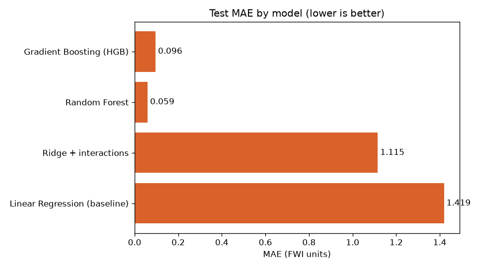
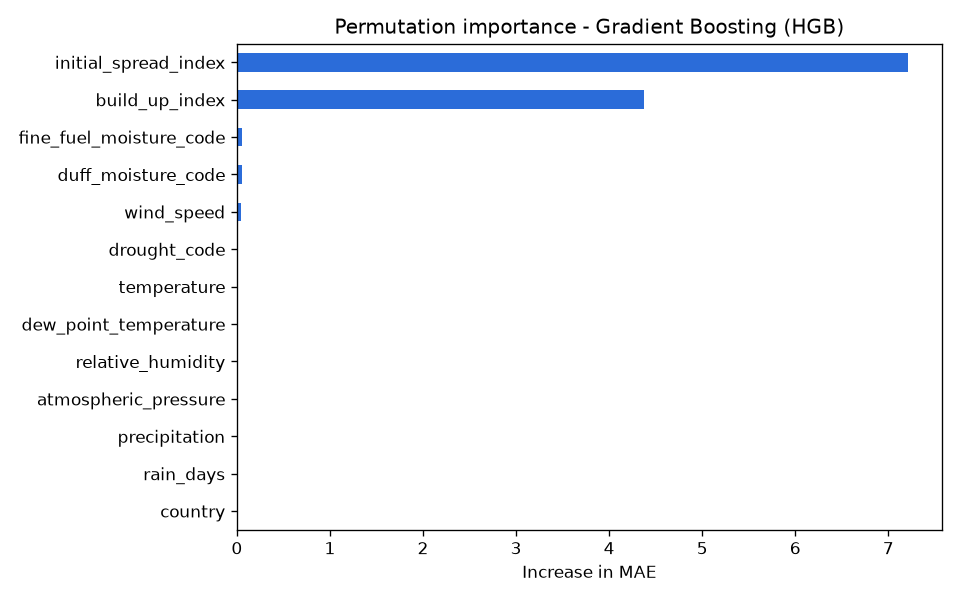
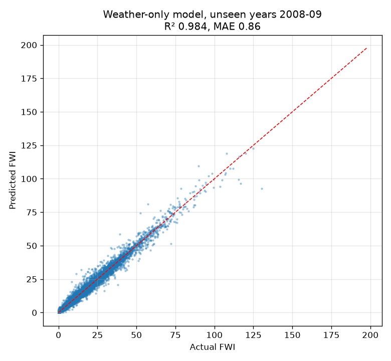

# Tempest FWI Predictor 🔥
**Internship 6.0 (B1)** · A machine-learning model and web app that predicts the Canadian **Fire Weather Index (FWI)** from daily weather observations and fuel-moisture codes.



## Results (held-out test set, 203,304 station-days)

| Model | MAE | MSE | RMSE | R² | Danger-class accuracy |
|---|---|---|---|---|---|
| Linear Regression (baseline, LR_v1) | 1.419 | 28.11 | 5.30 | 0.801 | 90.5% |
| Ridge + interaction terms (α≈3.16, notebook "final") | 1.115 | 14.88 | 3.86 | 0.895 | 92.7% |
| Random Forest (250k-row sample) | **0.060** | **0.079** | **0.28** | **0.9994** | **99.4%** |
| **Histogram Gradient Boosting — deployed model** | 0.096 | 0.181 | 0.43 | 0.9987 | 99.3% |
| *Official FWI equation (reference, not ML)* | *0.043* | *0.003* | *0.06* | *1.0000* | *99.5%* |

* FWI ranges 0–187 in the test set (mean 8.6), so an MAE of 0.1 is about 1% of a typical value.
* **Tree models cut the error of the tuned Ridge model by ~92%.** The linear models systematically over-predict high FWI values (see `reports/figures/actual_vs_predicted.png`) because FWI is strongly non-linear in its inputs.
* **Deployed model:** Gradient Boosting. Random Forest is slightly more accurate but its file is 157 MB (over GitHub's 100 MB limit); HGB is 1.5 MB and within 0.04 MAE of it.
* Danger classes use the CWFIS bands: Low 0–5, Moderate 5–10, High 10–20, Very high 20–30, Extreme 30+.

MAE of the deployed model by danger class:

| Class | Rows | MAE |
|---|---|---|
| Low (0–5) | 108,803 | 0.047 |
| Moderate (5–10) | 32,126 | 0.072 |
| High (10–20) | 36,046 | 0.086 |
| Very high (20–30) | 14,569 | 0.151 |
| Extreme (30+) | 11,760 | 0.569 |

### Key finding: FWI is a known formula of ISI and BUI
In the Canadian FWI System (Van Wagner, 1987), FWI is computed directly from the **Initial Spread Index (ISI)** and **Build-Up Index (BUI)**. Applying that equation (`src/fwi_equations.py`) to the test set reproduces the reported FWI with MAE 0.043 — essentially rounding error. Permutation importance confirms the model relies almost entirely on ISI and BUI:



So, with ISI and BUI as inputs, the models are learning a known physical equation. That's a valid exercise (and a good check that the pipeline is correct), and the web app shows the equation value next to the ML prediction for transparency. A harder and more useful follow-up is listed under *Future work*.

## Data
* **Source:** Canadian Wildland Fire Information System (CWFIS), Natural Resources Canada — daily noon station observations 2000–2009 (`cwfis_fwi2000s.csv`, 3.28M rows, 1,068 stations with complete FWI values).
* **Stations:** `cwfis_allstn2025.csv`, used to map each WMO station id to a country (Canadian province codes → Canada, US state codes → United States).
* **Cleaning** (`src/data_preprocessing.py`): drop rows without FWI codes (blank outside the fire season), drop physically impossible values (e.g. RH > 100, FFMC > 101), de-duplicate → **1,270,647 rows** (90.1% Canada, 9.9% US).
* **Split:** 60% train / 24% dev / 16% test, stratified by country (same ratios as `data_cleaning.ipynb`).

> The original notebooks used the 2010s file plus European stations; those files weren't in the project folder, so this pipeline uses the 2000s data that was. The code works unchanged with any CWFIS `cwfis_fwi*.csv` export.

## Features
13 inputs, the same ones as the original HMI form:

| Weather | FWI system codes | Other |
|---|---|---|
| temperature, dew point, relative humidity, wind speed, pressure, precipitation, rain days | FFMC, DMC, DC, BUI, ISI | country |

Feature engineering (`src/feature_engineering.py`) reproduces the notebook work inside one scikit-learn `Pipeline`: Yeo-Johnson power transform on skewed columns, standard scaling, one-hot country, the 16 interaction terms and 3 square-root terms from LR_v2–v4/Ridge, and a Yeo-Johnson transformed target for the linear models. Because the whole pipeline is saved as **one file**, the app and the evaluation transform data exactly the same way as training (the notebooks needed four separate pickles and manual inverse transforms).

## Project structure
```
├── app/
│   ├── app.py                 Flask web app + JSON API
│   └── templates/             index.html (calculator), forecast.html (forecast + map)
├── src/
│   ├── config.py              paths, columns, valid ranges
│   ├── data_preprocessing.py  load → map country → clean → split
│   ├── feature_engineering.py sklearn pipelines (power transform, scaling, OHE, interactions)
│   ├── model_development.py   train LR, Ridge, Random Forest, tuned Gradient Boosting
│   ├── model_evaluation.py    test metrics, plots, permutation importance
│   └── fwi_equations.py       official FWI equation (reference)
├── models/fwi_model.joblib    deployed model (full pipeline)
├── reports/                   metrics (CSV/JSON) and figures
├── notebooks/                 original EDA, VIF and model-iteration notebooks
├── legacy_artifacts/          original pickles used by the notebooks
├── tests/test_pipeline.py
├── run_pipeline.py
├── serve.py                   production server (Waitress)
├── render.yaml                Render deploy blueprint
├── .github/workflows/ci.yml   GitHub Actions tests
├── Dockerfile
└── requirements.txt
```

## How to run
```bash
python -m venv .venv && source .venv/bin/activate   # Windows: .venv\Scripts\activate
pip install -r requirements.txt

# 1. Put the data in data/raw/
#    cwfis_fwi2000s.csv and cwfis_allstn2025.csv (CWFIS datamart)

# 2. Preprocess → train → evaluate (about 5 minutes on a laptop)
python run_pipeline.py
#    quick run: python run_pipeline.py --sample 200000

#    weather-only model + unseen-year / unseen-station validation (~6 min)
python -m src.weather_features
python -m src.advanced_validation

# 3. Start the web app → http://localhost:5000  (Calculator + 3-day forecast)
python serve.py          # production server (Waitress, works on Windows)
# python app/app.py      # Flask dev server, for debugging

# 4. Tests
pytest -q
```

## Put it on GitHub and deploy
```bash
git init
git add .
git commit -m "Tempest FWI Predictor"
git branch -M main
git remote add origin https://github.com/<your-username>/tempest-fwi-predictor.git
git push -u origin main
```
Then on render.com: **New → Blueprint →** pick the repo. Render reads `render.yaml` and gives you a public URL.

### API
```bash
curl -X POST http://localhost:5000/api/predict -H "Content-Type: application/json" -d '{
  "temperature": 22.5, "dew_point_temperature": 8, "relative_humidity": 40,
  "wind_speed": 15, "atmospheric_pressure": 1012, "precipitation": 0, "rain_days": 3,
  "fine_fuel_moisture_code": 88, "duff_moisture_code": 35, "drought_code": 250,
  "build_up_index": 50, "initial_spread_index": 6, "country": "Canada"}'
# → {"fwi": ..., "danger_class": "...", "equation_fwi": ..., "color": "..."}
```

### Docker / cloud
```bash
docker build -t tempest-fwi .
docker run -p 8000:8000 tempest-fwi
```
The image runs with gunicorn and reads `PORT`, so it deploys as-is to Render, Railway, Azure App Service or Google Cloud Run.

## Model history (from the notebooks)
| Version | What changed | Outcome |
|---|---|---|
| LR_v1 | Independent features, normal-ish via power transform | High bias |
| LR_v2–v4 | Added interaction terms for non-linearity | Bias and variance remained |
| VIF analysis | Removed collinear features (BUI, DMC×DC, ISI, …) | Collinearity reduced, accuracy not improved |
| Ridge (± VIF) | L2 regularisation, α tuned by iterative grid search | Small gain over LR |
| Release 1 | Unified pipeline, full dataset, tree ensembles | **MAE 1.42 → 0.096** |
| Upgrade 1–2 | Weather-only model, unseen-year and unseen-station tests | R² 0.984 with no FWI codes |
| Upgrade 3–6 | Live 3-day forecast, map UI, CI, Render deploy | Works for any town |

## Upgrade: weather-only model + honest validation
To remove the ISI/BUI shortcut, a second model predicts FWI from **weather alone**, with no FFMC, DMC, DC, BUI or ISI inputs. It gets the fuel's "memory" from per-station rolling weather history instead (`src/weather_features.py`): rain totals over 3/7/14/30/60 days, days since ≥2 mm of rain, 3/7/30-day mean temperature and humidity, 7-day max temperature and min RH, yesterday's weather, day of year, and station latitude, longitude and elevation (35 features).

Both models were tested three ways (`src/advanced_validation.py`):

| Model | Validation | MAE | RMSE | R² | Danger-class accuracy |
|---|---|---|---|---|---|
| Full-input (13 inputs incl. codes) | Random split | 0.094 | 0.36 | 0.9991 | 99.3% |
| Full-input | **Unseen years** (train 2000–07, test 2008–09) | 0.107 | 0.43 | 0.9989 | 99.2% |
| Full-input | **Unseen stations** (20% of stations held out) | 0.086 | 0.31 | 0.9992 | 99.3% |
| **Weather-only** (no FWI codes) | Random split | 0.741 | 1.34 | 0.987 | 92.3% |
| **Weather-only** | **Unseen years** | 0.856 | 1.60 | 0.984 | 91.7% |
| **Weather-only** | **Unseen stations** | 0.750 | 1.37 | 0.984 | 92.1% |

* With **no FWI-system codes at all**, the weather-only model explains 98.4% of FWI variance on years it never saw, and its error (MAE 0.86) is **23% lower than the original Ridge model that was given the codes** (MAE 1.12).
* Scores barely drop from a random split to unseen years or unseen stations, so the models generalise over time and space rather than memorising stations.
* Top drivers: today's wind speed, humidity and rain, then 3-day mean RH, 30-day mean temperature, days since rain and 3-day rain total. These match the physics of fuel drying.



The trained model is saved as `models/fwi_weather_only.joblib` (5.6 MB).

## Upgrade: 3-day fire danger forecast (live)
The app now has a **3-day forecast** page (`/forecast`). Type any town, for example *Kelowna* or *Fort McMurray*:

1. The place is geocoded with the free Open-Meteo geocoding API.
2. The last 92 days of hourly weather plus the next 3 days of forecast come from the Open-Meteo forecast API (no API key needed).
3. Hourly data is converted to CWFIS-style noon observations, with 24 h rain ending at noon.
4. The same rolling-history features are rebuilt and the **weather-only model** predicts FWI for the past week, today and the next 3 days.
5. Results are shown as colour-coded danger cards and a Leaflet map.

```bash
python -m src.forecast "Kelowna"                    # command line
curl "http://localhost:5000/api/forecast?place=Kelowna"   # JSON API
```
Forecast accuracy depends on the weather forecast itself. Outside Canada and the US the app shows a warning, because the model was trained only on North American stations.

## Upgrade: engineering and deployment
* **Production server:** `python serve.py` uses Waitress, which runs on Windows. Docker and Render use gunicorn.
* **CI:** `.github/workflows/ci.yml` runs the test suite on every push to GitHub.
* **Tests:** 7 tests, including an offline forecast test with a synthetic weather response (no internet needed).
* **One-click deploy:** `render.yaml` deploys the app on Render's free plan (New → Blueprint → pick the repo).

## Limitations
* The headline table uses a random split; the upgrade section shows unseen-year and unseen-station scores, which are very close.
* Training data is 2000–2009 Canada/US. Other climates (e.g. Europe, India) aren't represented.
* The largest errors are in the Extreme class (MAE 0.57), where data is sparsest.

## Future work
* Add SHAP explanations for each forecast day.
* Validate on later years (2010s, 2020s), including record seasons like 2023.

## Acknowledgments
Completed as part of Internship 6.0 (B1). Data: Natural Resources Canada, Canadian Wildland Fire Information System. FWI equations: Van Wagner, C.E. (1987), *Development and Structure of the Canadian Forest Fire Weather Index System*, Canadian Forestry Service, Technical Report 35.
